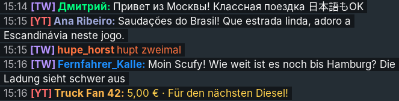
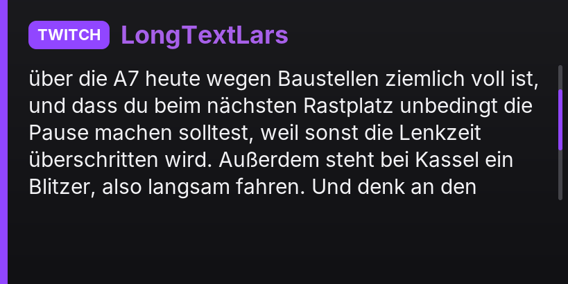

# Trucker Chat

**Livechat deines Streams im Euro Truck Simulator 2 – direkt auf dem Navi-Bildschirm im LKW.**
Viele Streamer fahren wegen des Urheberrechts ohne Radio. Trucker Chat zeigt stattdessen neue Chatnachrichten von
**Twitch** und **YouTube** kurz auf dem Navi im Cockpit (und auf Wunsch als Leiste oben im Bild). Danach läuft das Navi normal weiter.

*English: see [README.md](README.md).*

> ⚠️ **Stand: Version 0.1.1 Alpha – kompiliert, aber noch NICHT im Spiel getestet.**
> Die DLL wurde mit llvm-mingw gebaut, die plattformunabhängigen Teile (Chat-Parser, Filter, Textumbruch, Kartendarstellung)
> sind mit Unit-Tests geprüft. Alles, was das Spiel, Windows-Grafik oder echte Chat-Server braucht, ist ungetestet –
> siehe [Was nur im Spiel getestet werden kann](#was-nur-im-spiel-getestet-werden-kann).


## Installation

1. `trucker-chat.dll` nach `<Steam>\steamapps\common\Euro Truck Simulator 2\bin\win_x64\plugins\` kopieren
   (Ordner `plugins` ggf. anlegen). **Nur diese eine Datei** – keine EXE, kein Browser, kein Server, kein Python/Node.
2. Spiel starten. Die Meldung zu „Advanced SDK features“ mit OK bestätigen.
3. Beim ersten Start legt das Plugin neben der DLL den Ordner `trucker-chat\` an:
   `trucker-chat.json` (deine Einstellungen), `trucker-chat.example.json` (Standardwerte), `fonts\` (eingebettete Schrift Inter) und `trucker-chat.log`.
4. Im Spiel **`Strg+9`** drücken: das Menü öffnet sich (siehe [Menü](#menü)). Dort Twitch-Kanal / YouTube eintragen und speichern –
   kein Neustart nötig. (Alles lässt sich auch weiterhin in `trucker-chat.json` einstellen.)

## Menü

`Strg+9` öffnet und schließt das Einstellungsfenster (auch `Esc` oder „Schließen“). Es liegt über dem Spiel und wird **mit der Maus** bedient:

- **Chat im LKW anzeigen** – Chat an/aus, wirkt sofort und wird gespeichert.
- **Dauerhaft einblenden** – die letzten Nachrichten (`display.listSize`, Standard 4) bleiben als Liste dauerhaft auf dem Navi stehen und
  aktualisieren sich bei jeder neuen Nachricht; ohne Haken erscheinen sie nur kurz. Auch per `Strg+Umschalt+D`. Gilt auch für das Overlay.
- **Twitch:** aktiv + Kanal, daneben der aktuelle Verbindungsstatus.
- **YouTube:** aktiv + API-Schlüssel, **Stream-Link** einfügen: „Aus Zwischenablage einfügen“ übernimmt den kopierten Link sofort,
  „Link übernehmen“ (oder Enter) nimmt den eingetippten Link. Status daneben.
- **Anzeigedauer:** wie viele Sekunden eine Nachricht zu sehen ist (1–120, Pfeile oder eintippen). Wirkt sofort und wird gespeichert;
  gilt für die Karte auf dem Navi und das Overlay (`display.durationSeconds`, `overlay.durationSeconds`). Bei vollem Chat werden Karten automatisch etwas kürzer gezeigt.
- **Anzeige:** *Navi-Bildschirm im LKW* · *Seitenchat links (wie TruckersMP)* · *Navi + Seitenchat*. Wirkt sofort.
  Der **Seitenchat** zeigt die Nachrichten links im Bild als Zeilen „15:16 [YT] Name: Text“ auf dunklen Streifen; neue Zeilen kommen
  unten dazu, jede verschwindet nach der Anzeigedauer (mit „Dauerhaft einblenden“ bleiben sie stehen). Er zeichnet nur ins Spielbild,
  nicht aufs Navi – damit gibt es **keine Überschneidung mit Realistic Radio**. Einstellungen unter `side` in `trucker-chat.json`
  (`lines`, `offsetX`, `offsetY` = Abstand vom unteren Rand, `scale`, `width`, `background`, `showTime`, `showTag`).

  
- **Menü-Taste:** Feld anklicken und die neue Kombination drücken (z. B. `Strg+Umschalt+M`); eine Taste ohne Strg/Umschalt/Alt bekommt automatisch `Strg` dazu.
- **Speichern** schreibt alles in `trucker-chat.json` und verbindet Twitch/YouTube bei Änderungen neu – ohne Neustart.

Solange das Menü aktiv ist, bekommt das Spiel keine Tasten/Maus. Hinweis: Das Menü ist ein normales Windows-Fenster über dem Spiel.
Im **exklusiven Vollbild** kann Windows das Spiel beim Öffnen kurz minimieren – mit „Vollbild-Fenster“/randlosem Modus passiert das nicht
(im Spiel ungetestet, siehe unten).

Läuft **gleichzeitig mit Realistic Radio** (eigener DLL-Name, Ordner, Mutex, Fensterklassen, Log-Datei; siehe [unten](#zusammen-mit-realistic-radio)).

## Chat-Quellen

### Twitch (ohne Login)
```json
"twitch": { "enabled": true, "channel": "scufyking", "username": "", "oauthToken": "" }
```
`channel` darf auch `#Name` oder `https://twitch.tv/Name` sein. Verbindung: Twitchs offizielle IRC-WebSocket-Schnittstelle
`wss://irc-ws.chat.twitch.tv:443` (TLS über Windows' WinHTTP).

**Ehrlicher Hinweis:** Ohne Token meldet sich das Plugin nur lesend als `justinfanNNNNN` an. Das wird seit Jahren von vielen
Chat-Tools genutzt, steht aber **nicht in Twitchs Dokumentation** (dort ist nur die Anmeldung mit OAuth-Token beschrieben;
Twitch empfiehlt inzwischen EventSub). Falls Twitch das abschaltet: `username` (dein Twitch-Login) und `oauthToken`
(User-Token mit Scope `chat:read`) eintragen – dann wird die dokumentierte Anmeldung genutzt. Der Token landet nie im Log.

### YouTube Live – zwei Wege

**A) Ohne API-Schlüssel (Standard, wenn kein Schlüssel eingetragen ist)**
```json
"youtube": { "enabled": true, "apiKey": "", "channel": "@DeinKanal" }
```
Im Menü (`Strg+9`) einfach „YouTube aktiv“ anhaken, API-Key leer lassen, Stream-Link einfügen oder Kanal eintragen.
Das Plugin liest den Chat so, wie ihn die YouTube-Webseite selbst lädt (Video-Seite → Live-Chat-Seite → `youtubei/v1/live_chat/get_live_chat`;
derselbe Ablauf wie in den Open-Source-Tools yt-dlp und chat-downloader). Vorteile: keine Google Console, kein Kontingent, nur 1,5–10 s Verzögerung.
Ohne Link sucht es über `youtube.com/@Kanal/live`, ob du gerade live bist.

> ⚠️ **Inoffiziell:** Diese Schnittstelle ist von Google nicht dokumentiert und kann sich jederzeit ändern – dann braucht das Plugin ein Update
> (oder du nutzt solange Weg B). YouTubes Nutzungsbedingungen sehen automatisierten Zugriff eigentlich nur über die offizielle API vor;
> das Plugin liest nur den öffentlichen Chat, ohne Anmeldung, im Tempo der Webseite. Nicht gelistete Streams gehen per Link, private nicht.
> Für EU-Nutzer schickt das Plugin das Cookie `SOCS=CAI` („Zustimmung erteilt“) mit, sonst zeigt YouTube statt des Videos die Zustimmungsseite.

**B) Mit API-Schlüssel (offizielle YouTube Data API v3)** – wird automatisch benutzt, sobald ein Schlüssel eingetragen ist
(`"mode": "auto"`; erzwingen mit `"mode": "api"` bzw. `"mode": "web"`).
```json
"youtube": { "enabled": true, "apiKey": "AIza…", "video": "", "channel": "@DeinKanal", "pollSeconds": 12 }
```
**API-Schlüssel einrichten (einmalig, kostenlos):**
1. <https://console.cloud.google.com/> öffnen, oben ein **neues Projekt** anlegen.
2. „APIs & Dienste“ → „Bibliothek“ → **YouTube Data API v3** suchen → **Aktivieren**.
3. „APIs & Dienste“ → „Anmeldedaten“ → „Anmeldedaten erstellen“ → **API-Schlüssel**.
4. Schlüssel bearbeiten → „API-Einschränkungen“ → nur „YouTube Data API v3“ erlauben (empfohlen).
5. Schlüssel in `youtube.apiKey` eintragen.

**Welcher Stream?** Drei Wege, beliebig kombinierbar:
- **Link pro Stream (am einfachsten):** Stream-Link kopieren (aus YouTube, YouTube Studio oder youtu.be) und im Spiel
  **`Strg+Umschalt+Y`** drücken – sofort übernommen, ohne Neustart. Oder den Link in `trucker-chat\youtube-stream.txt`
  einfügen und speichern; das Plugin prüft die Datei alle 1,5 Sekunden. Der zuletzt übernommene Link wird dort gespeichert
  und beim nächsten Start wieder benutzt.
- `video` in der JSON: fester Link/ID.
- `channel` (`@Handle`, Kanal-ID `UC…` oder Kanal-Link): das Plugin sucht alle `searchMinutes` Minuten selbst nach deinem Livestream.
  Ist ein eingefügter Link schon beendet, wird automatisch wieder auf dem Kanal gesucht.

Ein eingefügter Link spart Kontingent (keine Suche nötig).

**Kontingent:** Ein Google-Projekt hat standardmäßig 10.000 Einheiten pro Tag; jede Chat-Abfrage (`liveChatMessages.list`)
kostet 5 Einheiten. Mit `pollSeconds: 12` reicht das für ca. **6,7 Stunden Livestream pro Tag** (12 s Verzögerung).
Kleinere Werte = schnellerer Chat, aber kürzere Laufzeit (z. B. 6 s → ca. 3,3 h). Laut aktueller Kontingenttabelle hat
`search.list` ein eigenes Limit von 100 Aufrufen pro Tag – deshalb sucht das Plugin nur alle 5 Minuten. Ist das Kontingent
aufgebraucht, zeigt das Navi einen Hinweis und das Plugin versucht es alle 30 Minuten erneut.
Beim Verbinden werden ältere Nachrichten übersprungen (`showBacklog: false`).

### Kick – nicht enthalten
Kick hat eine offizielle API, liefert Chatnachrichten aber nur per **Webhook** (Kick ruft eine öffentlich erreichbare
HTTPS-Adresse auf; dazu OAuth-Freigabe durch den Streamer). Das geht nur mit einem eigenen Server – genau das soll das
Plugin nicht brauchen. Der Live-Chat über Kicks internen WebSocket ist **inoffiziell**, nicht dokumentiert und kann jederzeit
brechen. Deshalb ist Kick bewusst weggelassen.

Mehrere Quellen laufen gleichzeitig; jede Nachricht zeigt Plattform (TWITCH/YOUTUBE), Namen und Text.
Bei Abbruch wird automatisch neu verbunden (2 s … 60 s Wartezeit, Twitch-`RECONNECT` und PING/PONG werden beachtet).

## Anzeige

**Navi-Bildschirm (Hauptfunktion).** Neue Nachricht → einige Sekunden Karte mit Plattform-Etikett, Name (in der Twitch-Namensfarbe) und Text
(mehrzeilig, Schrift wird bei langen Texten kleiner; sehr lange Texte werden mit „…“ gekürzt oder – `longText: "scroll"` – Zeile für Zeile durchgescrollt)
→ danach wieder Navi. Bei vollem Chat werden Karten kürzer gezeigt; wartende Nachrichten sind auf `maxQueue` begrenzt (die ältesten fallen weg).
Alternativ `display.mode: "list"`: die letzten `listSize` Nachrichten als Liste.

| Karte | Liste | Super Chat | Langer Text (scrollend) |
|---|---|---|---|
|  |  |  |  |

*Vorschaubilder: echter Karten-Code des Plugins (`src/Cards.cpp`), unter Linux mit FreeType statt GDI gerendert, auf einem
Platzhalter-Hintergrund. Im Spiel liegt die Karte über dem Navi. Emojis werden in der Vorschau nicht gezeichnet.*

Standardwerte (aus Realistic Radio übernommen, dort getestet: **MAN TGX, ETS2 1.61, Navi**): `width 1024, height 1024, format 29,
flipY true, areaX 0.1, areaY 0.3, areaW 0.8, areaH 0.4`. Die Karte wird in der Pixelgröße des sichtbaren Ausschnitts gerendert (819 × 410), damit nichts verzerrt.

**Andere LKW einrichten** (wie bei Realistic Radio):
1. `"probe": true` → das Plugin markiert nacheinander alle Kandidaten-Zeichenflächen mit einem Schachbrett und schreibt sie ins Log.
   Erscheint das Muster auf dem Navi, die Werte `Breite×Höhe` und `f<Format>` als `width`, `height`, `format` eintragen, `probe` wieder `false`.
2. `"grid": true` → ein Koordinatengitter (Zehntel) liegt über der ganzen Fläche; daran `areaX/areaY/areaW/areaH` ablesen
   (`flipY`/`flipX`, falls das Bild gespiegelt erscheint), `grid` wieder `false`.

**Overlay oben im Bild** (Standard: aus): `"overlay": { "enabled": true }` – zeigt die letzten Nachrichten als halbtransparente Leiste
(`position`, `offsetX/Y`, `scale`, `width`, `background`, `durationSeconds`). `mode: "auto"` zeichnet in D3D11 und weicht bei OpenGL auf ein transparentes Fenster aus.


## Zusammen mit Realistic Radio

Beide bleiben **eigenständige Plugins** (`realistic-radio.dll` und `trucker-chat.dll` nebeneinander im Ordner `plugins\`).

* **Ab Realistic Radio 1.4.3 zeichnet das Radio den Chat mit.** Trucker Chat erkennt beim Start, dass `realistic-radio.dll`
  geladen ist, und hängt sich dann **gar nicht** an Direct3D. Es gibt seine Bilder an das Radio weiter, und dessen Hook zeichnet
  erst das Radio, dann den Chat. Zwei Hooks an denselben Stellen konnten das Spiel abstürzen lassen – mit nur einem Hook fällt das weg.
  Im Log steht dann `Realistic Radio: linked`.
* **Gleicher Navi-Bereich:** Der Chat zeichnet dort, wo das Radio zeichnet – Zeichenfläche, Bereich und Drehung kommen aus den
  LKW-Presets von Realistic Radio und wechseln mit dem LKW mit. Eigene Werte für den Chat: `"screen": { "followRadio": false }`.
* **Der Chat wartet auf das Radio:** Zeigt das Radio gerade eine Karte (Senderwechsel, Lautstärke, Start-Logo), erscheint die
  Nachricht danach (`screen.radioCoexist: "yield"`, Standard). Ist die Radioanzeige dauerhaft eingeblendet, liegt der Chat darüber.
* Tasten, die man im Chat-Menü tippt, steuern das Radio nicht (ab Realistic Radio 1.4.3).
* **Ältere Realistic-Radio-Versionen** (bis 1.4.2) haben diese Schnittstelle nicht. Dann zeichnet Trucker Chat **nur den Seitenchat**
  und nicht aufs Navi, damit nicht zwei Hooks in die Navi-Zeichenflächen greifen; im Log steht ein Hinweis zum Aktualisieren.
* Ohne Realistic Radio arbeitet Trucker Chat wie bisher mit eigenem Hook.
* Getrennt bleiben: Ordner `trucker-chat\`, Mutex `Local\TruckerChatPlugin-<PID>`, Log `trucker-chat.log`. Der Dateiname des
  Radios lässt sich mit `screen.radioModule` ändern (Standard `realistic-radio.dll`).

## Bedienung

| Aktion | Standardtaste | Einstellung |
|---|---|---|
| Menü öffnen/schließen | `Strg+9` | `keys.menu` (oder im Menü ändern) |
| Chat-Anzeige an/aus | `Strg+Umschalt+C` | `keys.toggle` |
| Dauerhaft einblenden an/aus | `Strg+Umschalt+D` | `keys.pin` / `display.alwaysVisible` |
| Letzte Nachrichten erneut einblenden | `Strg+Umschalt+R` | `keys.replay` |
| Anzeige pausieren / fortsetzen | `Strg+Umschalt+P` | `keys.pause` |
| YouTube-Link aus der Zwischenablage übernehmen | `Strg+Umschalt+Y` | `keys.youtubeLink` |

Tasten frei belegbar (`"F9"`, `"Ctrl+Alt+K"`, `"Numpad5"`, `"0x7B"` …), optional Controller-Tasten (`buttons`, `controllerIndex`).
Tasten wirken nur, wenn ETS2 im Vordergrund ist (`onlyWhenGameFocused`). Bei ausgeschalteter Zündung keine Einblendungen
(`display.powerSource`: `ignition` | `engine` | `always`), im Pausenmenü wird angehalten.

## Filter und Sicherheit

* `filters.hideCommands` + `commandPrefixes` (Standard `!`): Befehle ausblenden.
* `filters.ignoreUsers`: Bots (Nightbot, StreamElements, Streamlabs, Moobot, Fossabot … voreingestellt).
* `filters.blockedWords` + `blockedWordsAction` (`hide` oder `mask` → `****`).
* `filters.links`: `mask` (Standard, wird zu `[Link]`), `hide` oder `show`.
* Von Moderatoren gelöschte Nachrichten / gebannte Nutzer verschwinden auch im LKW (Twitch `CLEARMSG`/`CLEARCHAT`, YouTube Bann/gelöschte Nachricht).
* `display.minIntervalSeconds` (Mindestabstand), `display.maxTextLength` (Zeichen), `display.maxLines`.
* Text wird abgesichert: ungültiges UTF-8 → `�`, Steuerzeichen, unsichtbare Zeichen und Bidi-Umkehrzeichen werden entfernt,
  „Zalgo“-Text gekappt, Hautton-/Variantenzeichen entfernt. Zeichen, die keine Schrift hat, werden ersetzt statt als leere Kästchen gezeigt.
* Emojis: `display.emoji` = `keep` (Windows-Schrift „Segoe UI Emoji“, **einfarbig**, weil GDI keine Farb-Emojis zeichnet), `replace` (`emojiReplacement`) oder `remove`.
* Zugangsdaten (API-Schlüssel, Token) werden nie geloggt – jede Logzeile wird zusätzlich davon bereinigt; der YouTube-Schlüssel geht im Header, nicht in der URL.
* `logMessages: true` schreibt Chatnachrichten ins Log (Standard: aus).

## Alle Einstellungen

Siehe `trucker-chat.example.json` (wird bei jedem Update neu geschrieben). Fehlende Schlüssel in deiner Datei bekommen automatisch den Standardwert;
bei einem JSON-Fehler läuft das Plugin mit Standardwerten und überschreibt deine Datei **nicht** (Fehler steht im Log). `//`-Kommentare sind erlaubt.

## Selbst bauen

Windows (Visual Studio 2022, CMake):
```
cmake -B build -A x64
cmake --build build --config Release
```
Cross-Build unter Linux mit [llvm-mingw](https://github.com/mstorsjo/llvm-mingw) (`bin/` im `PATH`):
```
cmake -B build -G Ninja -DCMAKE_TOOLCHAIN_FILE=toolchain-mingw.cmake
cmake --build build
```
Der Build ist reproduzierbar (kein Zeitstempel im PE-Kopf, Pfade werden entfernt): zwei Builds aus verschiedenen Ordnern ergaben dieselbe SHA-256.
Unter Linux/macOS (ohne Toolchain-Datei) baut dasselbe CMake-Projekt `tc-tests` (Unit-Tests) und `tc-preview` (Vorschaubilder, braucht FreeType + zlib):
```
cmake -B dev -G Ninja && cmake --build dev && ./dev/tc-tests
./dev/tc-preview data/fonts docs/preview /usr/share/fonts/truetype/dejavu/DejaVuSans.ttf
```

## Was nur im Spiel getestet werden kann

Getestet wurden: Kompilierung (llvm-mingw, keine Warnungen), Exporte `scs_telemetry_init`/`scs_telemetry_shutdown`, eingebettete Ressourcen,
106 Unit-Tests (UTF-8, Bereinigung, Filter, Twitch-IRC-Parser, YouTube-Antworten, Textumbruch) unter AddressSanitizer, Mutations-Fuzzing der Parser,
Vorschaubilder des Karten-Codes. **Nicht getestet – bitte im Spiel prüfen:**

- [ ] Plugin lädt in ETS2 1.5x/1.6x, Ordner/Log/Schriften werden angelegt.
- [ ] Twitch-Verbindung (WinHTTP-WebSocket, anonyme Anmeldung), Wiederverbindung, PING/PONG, gelöschte Nachrichten.
- [ ] YouTube ohne API-Schlüssel (Web-Modus): Video-/Chat-Seite lesbar, Polling, `@Kanal/live`-Erkennung, EU-Zustimmungsseite.
- [ ] YouTube mit API-Schlüssel: `@Handle`-Auflösung, Live-Suche, Polling, Kontingent-Meldung, Link per `Strg+Umschalt+Y` / `youtube-stream.txt`.
- [ ] Karte erscheint auf dem Navi (MAN TGX), richtige Ausrichtung, keine Verzerrung, Navi erscheint danach wieder.
- [ ] GDI-Darstellung mit der eingebetteten Inter-Schrift und den Windows-Ersatzschriften (Kyrillisch, CJK, einfarbige Emojis).
- [ ] Gleichzeitiger Betrieb mit Realistic Radio (Seitenchat und Navi-Modus).
- [ ] Menü (`Strg+9`): erscheint über dem Spiel, Maus frei, Speichern ohne Neustart, Menü-Taste ändern, Verhalten im exklusiven Vollbild.
- [ ] Overlay oben (D3D11 und Fenstermodus), Tasten, Zündung aus, Pause-Menü.
- [ ] Bildrate: keine merkbaren Einbußen.

Bitte bei Problemen `trucker-chat\trucker-chat.log` mitschicken.

## Lizenz

Mozilla Public License 2.0 (`LICENSE`). Drittkomponenten und Hinweise: `NOTICE.md`.
Twitch und YouTube sind Marken ihrer Inhaber; dieses Projekt steht in keiner Verbindung zu ihnen oder zu SCS Software.
