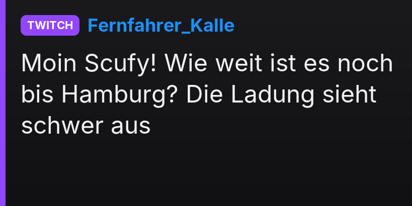
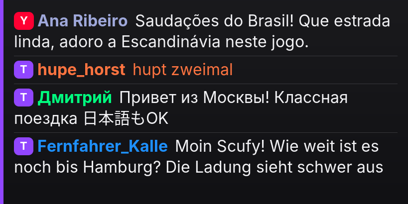
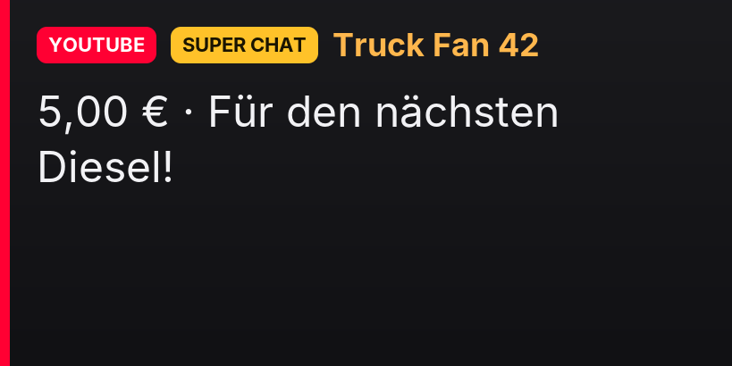
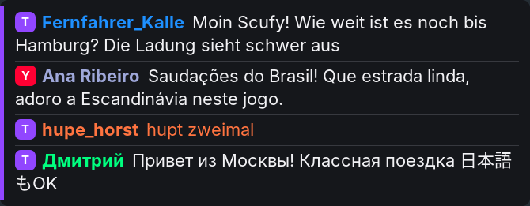

# Trucker Chat

**Your stream's live chat inside Euro Truck Simulator 2 – on the truck's navigation screen.**
Many streamers drive without radio because of copyright. Trucker Chat shows new **Twitch** and **YouTube** chat messages
for a few seconds on the in-cab navigation screen (optionally also as a bar at the top of the picture), then the navigation comes back.

*Deutsch: siehe [README.de.md](README.de.md).*

> ⚠️ **Status: version 0.1.0 Alpha – compiles, NOT yet tested in the game.**
> The DLL was built with llvm-mingw; the platform-independent parts (chat parsers, filters, word wrap, card rendering) are
> covered by unit tests. Everything that needs the game, Windows graphics or the real chat servers is untested – see
> [What can only be tested in the game](#what-can-only-be-tested-in-the-game).

## Installation

1. Copy `trucker-chat.dll` to `<Steam>\steamapps\common\Euro Truck Simulator 2\bin\win_x64\plugins\` (create `plugins` if needed).
   **That single file is all** – no EXE, no browser, no server, no Python/Node.
2. Start the game and confirm the "Advanced SDK features" message.
3. On first start the plugin creates `trucker-chat\` next to the DLL: `trucker-chat.json` (your settings),
   `trucker-chat.example.json` (defaults), `fonts\` (embedded Inter font) and `trucker-chat.log`.
4. Press **`Ctrl+9`** in the game to open the menu.

## Menu

`Ctrl+9` opens/closes a settings window on top of the game, used **with the mouse**: chat on/off (applies at once), **display time** per message ("Anzeigedauer", 1–120 s, applies at once), **"Dauerhaft einblenden"** (newest messages stay on the screen as a list, also `Ctrl+Shift+D` / `display.alwaysVisible`), Twitch on + channel,
YouTube on + API key, paste the **stream link** ("Aus Zwischenablage einfügen" / "Link übernehmen"), connection status, and the menu key
itself (click the field and press the new combination). "Speichern" writes `trucker-chat.json` and reconnects the sources – no restart.
While the menu is active the game gets no keyboard/mouse input. It is a normal Windows window: in *exclusive* fullscreen Windows may minimise
the game while it is open; borderless/windowed fullscreen avoids that (untested in the game).

Runs **side by side with Realistic Radio** (own DLL name, folder, mutex, window classes, log file).

## Chat sources

**Twitch (no login):** `"twitch": { "enabled": true, "channel": "scufyking" }`. Connects to Twitch's IRC WebSocket endpoint
`wss://irc-ws.chat.twitch.tv:443` (TLS via Windows WinHTTP). *Honest note:* without a token the plugin logs in read-only as
`justinfanNNNNN`. Many chat tools have done this for years, but it is **not in Twitch's documentation** (which describes OAuth login
and recommends EventSub). If Twitch ever blocks it, set `username` + `oauthToken` (user token with `chat:read`) to use the documented login.

**YouTube without API key (default when no key is set):** tick "YouTube aktiv" in the menu, leave the API key empty, paste the stream
link or set the channel. The plugin reads the chat the way the YouTube web page does (watch page → live_chat page → `youtubei/v1/live_chat/get_live_chat`,
same flow as yt-dlp / chat-downloader): no Google Console, no quota, 1.5–10 s delay; without a link it checks `youtube.com/@channel/live`.
⚠️ **Unofficial:** undocumented by Google and may break at any time; YouTube's terms intend automated access via the official API.
It only reads the public chat, without login, at the web page's pace. Sends the cookie `SOCS=CAI` so EU users don't get the consent page.

**YouTube Live with API key (official YouTube Data API v3)** – used automatically when a key is set (`"mode": "auto"`, force with `"api"`/`"web"`):
`"youtube": { "enabled": true, "apiKey": "AIza…", "video": "", "channel": "@YourChannel", "pollSeconds": 12 }`
Create the key once: Google Cloud Console → new project → *APIs & Services → Library* → enable **YouTube Data API v3** →
*Credentials → Create credentials → API key* → restrict it to YouTube Data API v3. **Easiest per stream:** copy the stream link (YouTube, YouTube Studio or youtu.be) and press **`Ctrl+Shift+Y`** in the game –
taken over immediately, no restart. Or paste it into `trucker-chat\youtube-stream.txt` and save (checked every 1.5 s; the last link is
remembered for the next start). Alternatively `video` (fixed link/ID) or `channel` (`@handle`, `UC…` id or channel URL; the plugin looks
for your live stream every `searchMinutes` and falls back to it when a pasted stream has ended).
Quota: 10,000 units/day per project by default; each chat poll costs 5 units → with `pollSeconds: 12` about **6.7 hours of streaming per day**.
Per the current quota table `search.list` has its own limit of 100 calls/day, so the plugin searches only every 5 minutes.

**Kick – not included.** Kick's official API delivers chat messages only via **webhooks** to a public HTTPS endpoint (plus OAuth by the
streamer) – that needs a server, which this plugin must not require. Reading chat through Kick's internal WebSocket is unofficial and undocumented.

Several sources can run at once; every message shows platform, name and text. Automatic reconnect with back-off (2–60 s).

## Display

**Navigation screen (main feature):** card with platform label, name (Twitch name colour) and multi-line text, shrinking the font for longer
text; very long text is cut with "…" or scrolled line by line (`longText: "scroll"`). Busy chats shorten the cards; the queue is limited
(`maxQueue`). `display.mode: "list"` shows the newest `listSize` messages instead.
Defaults from Realistic Radio, tested there on the **MAN TGX, ETS2 1.61 navigation**: `width 1024, height 1024, format 29, flipY true,
areaX 0.1, areaY 0.3, areaW 0.8, areaH 0.4`; the card is rendered at the visible area's pixel size (819 × 410).
Other trucks: `"probe": true` (marks candidate render targets one after another, see log) and `"grid": true` (coordinate grid in tenths to read areaX/Y/W/H).

**Overlay** at the top of the picture: `"overlay": { "enabled": true }` (default off). D3D11, with a transparent-window fallback for OpenGL.

| Card | List | Super Chat | Overlay |
|---|---|---|---|
|  |  |  |  |

*Previews are rendered by the plugin's real card code (`src/Cards.cpp`) on Linux with FreeType instead of GDI, on a placeholder background; emoji are not drawn there.*

## Together with Realistic Radio

Both plugins only swap single vtable entries (`IDXGISwapChain::Present`, `ID3D11DeviceContext::OMSetRenderTargets(AndUnorderedAccessViews)`)
and always call the **previous** pointer, so they chain in either load order; calls made by another hook while Trucker Chat forwards are passed through untouched.
Realistic Radio shows a ~4 s card on the same navigation area when the station/volume changes. With `screen.radioCoexist: "yield"` (default)
the chat steps aside while that card is visible: Trucker Chat recognises draw calls whose return address lies in `realistic-radio.dll`
(for this only, `ID3D11DeviceContext::Draw` is also watched) – no change to Realistic Radio. Alternatives: `"ignore"` plus a different `area…`,
or set Realistic Radio's own `screen.enabled` to `false` in its config.

## Controls

`Ctrl+9` menu · `Ctrl+Shift+D` always visible on/off · `Ctrl+Shift+C` chat display on/off · `Ctrl+Shift+R` show recent messages again · `Ctrl+Shift+P` pause/resume · `Ctrl+Shift+Y` take the YouTube link from the clipboard (all configurable in `keys`,
optional controller `buttons`). Keys work only while ETS2 is in the foreground. No messages while the ignition is off (`display.powerSource`), held while the game is paused.

## Filters and safety

Hide `!commands`, ignore bots (preset list), blocked words (`hide`/`mask`), links (`mask` → `[Link]` by default), minimum interval, maximum
length. Messages deleted by moderators / banned users also disappear in the truck. Text is sanitised (invalid UTF-8, control and bidi
characters, Zalgo, emoji modifiers); characters no font has are replaced. Emoji: `keep` (monochrome via Segoe UI Emoji – GDI draws no colour
emoji), `replace` or `remove`. API keys and tokens never reach the log (every line is scrubbed; the YouTube key is sent as a header, not in the URL).

## Building

Visual Studio 2022: `cmake -B build -A x64 && cmake --build build --config Release`
llvm-mingw cross build: `cmake -B build -G Ninja -DCMAKE_TOOLCHAIN_FILE=toolchain-mingw.cmake && cmake --build build` (reproducible: no PE timestamp, paths stripped).
On Linux/macOS without the toolchain file, the same project builds `tc-tests` (unit tests) and `tc-preview` (preview PNGs; FreeType + zlib).

## What can only be tested in the game

Tested: compilation (no warnings), exports, embedded resources, 106 unit tests under AddressSanitizer, parser fuzzing, card previews.
**Untested:** loading in ETS2; YouTube web mode against the real site; the menu (focus, mouse, fullscreen behaviour); Twitch/YouTube connections, reconnects, moderation deletes; drawing on the navigation screen
(orientation, scaling, navigation returning); GDI text with Inter and the Windows fallback fonts; running together with Realistic Radio in
both load orders incl. "yield"; overlay (D3D11 + window); keys, ignition, pause menu; frame-rate impact. Please attach `trucker-chat\trucker-chat.log` to bug reports.

## License

Mozilla Public License 2.0 (`LICENSE`); third-party notices in `NOTICE.md`. Not affiliated with Twitch, Google/YouTube or SCS Software.
